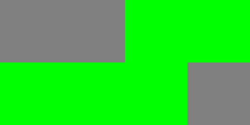
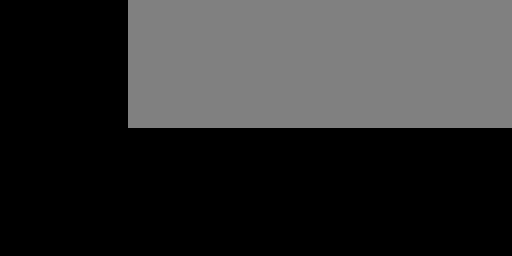

# D3D12 test apps

Small D3D12 applications that exercise the DXR replay paths of GFXReconstruct and judge the result on the GPU. Each
DXR app draws a 4x2 grid of 128x128 tiles, one tile per variant under test. A tile's shader reads known values through
the addresses under test (a TLAS, a shader table, a root argument in a hit record, an indirect argument) and writes
pass green, a fail color carrying a bit mask the app documents, or leaves the tile black. A replay of a capture of an
app is judged from a screenshot, on any adapter, without a reference image. The app itself judges its last frame on
the CPU, prints a line per tile and returns the failing tile count. `testapp_suite.py` builds the apps, runs each one
natively, under capture, in replay and in optimized replay on a GFXR build you name, and records every tile's verdict
at every step.

The apps test the replayer, not the driver: a tile that passes in the app's own report while it is captured and fails
at replay shows a replay defect or a limitation of the replay mode. A tile that fails or removes the device in the
app's own run says nothing about replay on that adapter; leave it out with `--case`.

Contents: running the suite and reading its results; running, capturing and replaying an app by hand; the apps and
their expected results; how the parts fit together.

## Running the suite

You need:

- Windows 10 or 11 with a D3D12 adapter that supports raytracing tier 1.1, or WARP (see "WARP").
- A GFXR build to test, built the usual way (BUILD.md) in the configuration the suite uses (Release by default). The
  suite never builds or writes into it.
- The same build tools, for the apps: Visual Studio with the C++ workload, CMake, and the Windows SDK BUILD.md names.
  The DXR apps compile their shaders with `dxc.exe` from the DXC SDK, which CMake downloads when it configures them.
- Python 3 (tested with 3.12) and Pillow: `python -m pip install -r test\test_apps\d3d12\requirements.txt`.
- For spreadsheets only: openpyxl (`python -m pip install openpyxl`).

Check out the revision with the test apps beside the GFXR checkout under test, then point the runner at that
checkout's build. As a worktree of the same repository:

```
cd C:\src\gfxr
git worktree add ..\gfxr-testapps <revision with the test apps>
cd ..\gfxr-testapps
python -m pip install -r test\test_apps\d3d12\requirements.txt
python test\test_apps\d3d12\testapp_suite.py --gfxr-build-dir C:\src\gfxr\build
```

Or as a separate clone:

```
git clone --recurse-submodules <repository> C:\src\gfxr-testapps
cd C:\src\gfxr-testapps
git checkout <revision with the test apps>
python -m pip install -r test\test_apps\d3d12\requirements.txt
python test\test_apps\d3d12\testapp_suite.py --gfxr-build-dir C:\src\gfxr\build
```

The runner configures `build\` of the test-app checkout if it has no CMake cache, builds the app targets there (that
is all it builds), takes the capture libraries, `gfxrecon-replay` and `gfxrecon-optimize` from the GFXR build, and
runs every app in four steps:

| Step | Runs |
|------|------|
| native | the app without GFXR; its own report on its last frame |
| capture | the app under the capture libraries with the D3D12 debug layer, trimmed to frames 30-60; its own report |
| replay | `gfxrecon-replay --validate --create-dummy-allocations` of the trim, every frame screenshotted and judged |
| optimized | `gfxrecon-optimize` on the trim, then its output replayed as for replay |

The GFXR build is only read. If the GFXR checkout is itself the one with the apps, name its build as both:
`--gfxr-build-dir build --build-dir build`; the runner then builds nothing, runs what that build has, and treats the
directory as the test-app build, so the results and a `--warp-dll` go there. A full run
of the five DXR apps takes one to two minutes after the build.

### Options

| Option | Effect |
|--------|--------|
| `--gfxr-build-dir DIR` | the GFXR build to test, only read unless it is also `--build-dir` (required) |
| `--build-dir DIR` | the test-app build (default: `build\` of the checkout) |
| `--config Release\|Debug` | the configuration of both builds (default Release) |
| `--no-build` | use the test-app build as it is |
| `--apps a,b` | run only these apps (default: all five DXR apps) |
| `--case app=tile,tile` | run only these tiles of an app; repeat for other apps |
| `--steps native,capture,replay,optimized` | run only these steps; replay and optimized need capture |
| `--replay-args="..."` | extra `gfxrecon-replay` arguments for both replays |
| `--warp`, `--warp-dll PATH` | use the software adapter (see "WARP") |
| `--output-dir DIR`, `--label NAME` | where results go and what they are called |
| `--xlsx` | also write the spreadsheet, with `testapp_sheet.py` (needs openpyxl) |
| `--verbose` | print every command and its output |

The runner never deletes or overwrites a file it did not create. If any of the label's results already exist, it
stops before the build; choose another `--label` or `--output-dir`.

### Reading the results

The console shows the two revisions, then one line per step of each app, with the tiles' verdicts counted and the
GFXR log messages of the step counted by kind:

```
GFXR my-feature 9071ac3 in C:\src\gfxr\build
test apps d3d12-dxr-test-apps ab2005b0
dxr-indirect
  native     5 pass, 1 not built                                        1.0 s
  capture    5 pass, 1 not built                                        1.2 s
  replay     5 pass, 1 empty, 31 frames                                 3.1 s
  optimized  5 pass, 1 empty, 31 frames, 1 ERROR                        3.4 s
```

A table of every tile's verdict at every step follows, with the messages spelled out, then the results path.
`--verbose` prints every command and its output as well; the logs hold them in any case.

Results go to `build\testapp_suite\` of the test-app checkout, named by a label that defaults to the tested branch
and the time (`my-feature-20261110T093000`):

| Path | Holds |
|------|-------|
| `<label>.json` | every verdict, the log messages, the adapters and drivers, the tested GFXR revision and the test apps' revision |
| `<label>.xlsx` | with `--xlsx`: the same as a spreadsheet |
| `<label>\build.log` | the apps' configure and build |
| `<label>\<app>\native.log`, `capture.log` | the command line and the app's output in those steps |
| `<label>\<app>\capture_gfxr.log` | GFXR's capture log |
| `<label>\<app>\<app exe>_frames_30_through_60_<time>.gfxr` | the trimmed capture |
| `<label>\<app>\replay.log`, `replay_screenshots\` | the replay and a screenshot of every frame |
| `<label>\<app>\optimize.log`, `*.optimized.gfxr` | gfxrecon-optimize and its output |
| `<label>\<app>\optimized_replay.log`, `optimized_screenshots\` | the replay of the optimized file |

Verdict words, per tile and step:

| Verdict | Meaning |
|---------|---------|
| `pass` | native and capture: the app's last frame passed; replays: every replayed frame passed |
| `fail bits=0x..` | the tile painted a fail color; the bits are documented per app below |
| `not run` | the tile is black: it ran and drew nothing |
| `empty` | the slot is gray on every frame: no tile ran there (not built, or left out by `--case`) |
| `mixed` | anything else, e.g. a tile partly painted |
| `not built`, `disabled` | the app's own report: the tile is not in this build, or `--case` left it out |
| `incomplete (N of M frames)`, `no frames` | the replay stopped early or did not run |

The `optimized` step's verdict covers `gfxrecon-optimize` and the replay of its output. Log messages are counted per
step for the whole app: an ERROR there is not tied to a tile.

The spreadsheet opens with the run's information, a row each: the GFXR branch and commit (and the test apps' when they
come from another checkout), date, GPU, driver, config and replay arguments, and whether a device loss stopped the run.
No machine or user name, so a sheet can be shared. The table shows one code per cell: PASS, PASS* (passed, but the
step logged an ERROR or FATAL), FAIL, BLACK, REMOVED / HANG / CRASH (the step lost the device or ended early), n/b (not
built) and - (not run or left out). Hovering a cell shows the details. A list of every log message follows the table,
and the legend of the codes ends the sheet. `python testapp_sheet.py <label>.json` writes the spreadsheet of an
earlier run, beside it.

### Things to know

- The runner stops at the first sign of a device loss (a device-removed result, a GFXR FATAL), so nothing more runs
  on a GPU in an unknown state. The device loss itself, a GPU reset (TDR), has happened by then.
- The default build leaves out the tiles known to hang a GPU or fail on current GFXR. Building them (see "Building")
  can hang the GPU on replay.
- dxr-acceleration-structures needs GFXR at or after 6b880c2d (#3373). On older revisions, the replay of its trim hangs
  the GPU while loading; leave the app out with `--apps`.
- Some drivers fail dxr-indirect tiles 2-4 in the app's own run, without GFXR. Leave them out with `--case` there.
- Known messages: `gfxrecon-optimize` logs "Failed to find the required data for DXR optimization" on dxr-indirect,
  and on WARP every validated replay logs D3D12 ERROR ID 1158 (an acceleration structure build that outgrows the buffer
  the app sized at capture). The tiles pass regardless, with the exception below; the causes are open.
- dxr-acceleration-structures is unstable on WARP at replay: with the same NuGet WARP 1.0.22 and the same GFXR, one
  machine passes every tile, another leaves every tile black (its BLAS builds fail on buffers far smaller than the
  build wants, the ID 1158 case), and a third loses the device after a dozen frames, with a hardware TDR alongside.
  Native and capture pass everywhere. Until the cause is found, leave the app out of WARP runs with `--apps`, and read
  a WARP result for it as unmeasured rather than failed.

### WARP

`--warp` uses the software adapter. The WARP that ships with Windows can be older than the apps need (it crashes on
dxr-acceleration-structures tile 4, `pointers-inactive`, whose instances have a null BLAS); the one in the
`Microsoft.Direct3D.WARP` NuGet package, 1.0.22 or later, is recommended. Download the package from nuget.org (a
`.nupkg` is a zip), take `build\native\bin\x64\d3d10warp.dll`, and pass it with `--warp-dll`. The runner copies it
beside each app in the test-app build, where it stays, so an app run by hand with `--warp` uses the same WARP, and
gives its copies of `gfxrecon-replay` and `gfxrecon-optimize` the same DLL for the run. Later runs with `--warp` find
it beside the apps without `--warp-dll`. Its license allows use for testing; do not commit or redistribute the DLL.

## An app by hand

### Building

- The apps are built in every Windows build with `D3D12_SUPPORT`, independent of `GFXRECON_INCLUDE_TEST_APPS` (the
  Vulkan test apps). The DXR apps are skipped with a CMake message when `dxc.exe` is missing (`cmake/FindDXC.cmake`,
  `DXC_EXE_PATH`); `dxgi-object-order` builds regardless.
- Executables: `build\test\test_apps\d3d12\<app>\<Config>\gfxrecon-testapp-d3d12-<app>.exe`, with the Agility SDK
  runtime under `D3D12\` beside each, as for `gfxrecon-replay.exe` (`cmake/AgilitySDK.cmake`).
- `GFXRECON_D3D12_TESTAPP_GPU_WRITTEN_TILES` (default OFF) builds the tiles marked GPU-written in the tables below.
  Their DXR addresses are written by compute shaders from root constants, so a replay that does not translate values
  written on the GPU hands the GPU capture-time addresses, which can hang it. Neither replay mode on dev translates
  them.
- `GFXRECON_D3D12_TESTAPP_KNOWN_DEFECT_TILES` (default OFF) builds the tiles marked known-defect. They reproduce replay
  defects and fail on a build without the fix; some leave shader records untranslated, which can fault the GPU. Turn
  the option on to test a fix for one of them.
- The options are cached: change them with `cmake -D<option>=ON build` or in a new build directory. A tile left out
  of the build stays gray and the app reports it as "not built". A default build passes in both replay modes on dev
  wherever its tiles pass in the app's own run.

### Running

```
gfxrecon-testapp-d3d12-<app>.exe [--warp] [--frames N] [--case a,b,...] [--debug-layer] [--ballast-mb N] [--no-vsync]
```

- `--frames N` renders N frames and judges the last one. 0, the default, runs until the window is closed and judges
  the last frame then.
- `--case` runs a subset of tiles, by the names in the tables below.
- `--debug-layer` enables the D3D12 debug layer and prints its warnings and errors at exit.
- `--warp` picks the WARP adapter instead of the first high-performance adapter with raytracing tier 1.1.
- A value may be joined (`--case=a,b`). The environment variable `GFXRECON_TESTAPP_ARGS` adds options for a launcher
  that cannot pass them.
- Output: one line per tile, `<app>: tile <i> <name>: pass | fail bits=0x.. | not run | not built | disabled`
  (disabled: left out by `--case`), the adapter name, the frame count, and an exit code equal to the number of failing
  tiles. 100 means the app itself failed (a FAIL line says what), 101 a bad option or an unknown `--case` name.

### Capturing

Capture the apps as frame-range trims. During initialization, before any test resource exists, an app allocates
ballast (a buffer of `--ballast-mb` MB, 64 by default, and a descriptor heap of 4096 descriptors) and releases it once
the test resources exist. A trim taken later never recreates the ballast, so at replay every GPU virtual address and
descriptor handle of the test resources lands elsewhere than at capture, and a value the replayer failed to translate
reads the wrong memory or faults. A full capture replays the ballast too and loses that property.

1. Copy the capture libraries beside a copy of the executable (see USAGE_desktop_D3D12.md, "Enabling D3D12 Capture").
2. `set GFXRECON_CAPTURE_FRAMES=30-60`. Frame 1 does the initialization, so any range after it works.
3. Run the app with `--frames 61`, or close its window after the range.

The app's own report during the capture run is the capture-time reference: judge a replay on the tiles that pass there.

### Replaying

| Mode | Command |
|------|---------|
| Replay | `gfxrecon-replay.exe <capture>`: Dx12ResourceValueMapper maps the resource values a submission uses before the submission executes. |
| Optimized | `gfxrecon-optimize.exe --dxr <capture> <optimized>`, then `gfxrecon-replay.exe <optimized>`: the optimizer records which writes carry the values, so replay maps them as the data is written. |

Recommended replay options for both modes:

- `--create-dummy-allocations`, so an untranslated address faults instead of reading whatever the capture-time
  address holds at replay.
- `--screenshot-all --screenshot-format png`, or `--screenshots N-M`, for the verdict.
- `--validate` once per mode, for the D3D12 debug layer.

### Reading a screenshot

A replay has no CPU-side report: the verdict is the replayed image. Every screenshot is the 512x256 verdict image, a
tile per 128x128 cell, numbered row-major from the top left (0 to 3 on the top row, 4 to 7 below).



dxr-command-contexts from a default build, replayed: tiles 2 to 6 pass; slots 0 and 1 hold its known-defect tiles,
which were not built, and slot 7 is past its last tile.



dxr-acceleration-structures replayed on one machine's WARP adapter (see "Things to know"): the five built tiles ran
and drew nothing; slots 1 to 3 hold its GPU-written tiles, which were not built.

| Color | Pixels | Verdict | Meaning |
|---|---|---|---|
| green | every pixel (0, 255, 0) | `pass` | the tile's check held |
| red | (255, 0, bits * 8) | `fail` | the check failed; the blue channel divided by 8 is the failure mask the app documents, OR'd over the tile |
| black | every pixel (0, 0, 0) | `not run` | the tile drew nothing; every frame starts by clearing the output, so a tile is green only if this replay painted it, even though a trim's state block seeds the output with the captured image |
| gray | every pixel (128, 128, 128) | `empty` | no tile in the slot: past the app's last tile, not built, or left out by `--case` at capture |
| anything else | | `mixed` | a tile that is neither one color nor a fail color, e.g. painted in part |

A replay fault shows as a device removal in the replay log, not in the image.

## The apps and their expected results

Each tile tests one way a DXR value reaches the GPU. The tables give the expected result of each tile on a trimmed
capture in both replay modes, and the GFXR revision the pass is expected on. GPU-written marks the tiles behind
`GFXRECON_D3D12_TESTAPP_GPU_WRITTEN_TILES`, known-defect the tiles behind `GFXRECON_D3D12_TESTAPP_KNOWN_DEFECT_TILES`; a
default build leaves both out. Every tile built by default was measured on dev 63f86f2e on hardware of three GPU
generations and on WARP, at capture and in both replay modes, with a screenshot of every replayed frame. `--validate`
reported no D3D12 debug-layer message on the hardware. On WARP, a validated replay of every DXR app reports D3D12 ERROR
ID 1158: an acceleration structure build needs more memory than the buffer the app sized from its prebuild info at
capture. The tiles pass regardless, except dxr-acceleration-structures on some machines (see "Things to know"); the
cause is open.

### dxr-basic (3 tiles)

The shared scene (`common/dxr_scene.*`): one quad in a BLAS, a TLAS over one instance, and a state object whose hit
group record carries a root constant, a root CBV address and a descriptor-table handle. Fail bits: 1 root constant,
2 root CBV, 4 descriptor table, 8 InstanceID, 16 miss.

| Tile | Exercises | Replay | Optimized | Expected to pass on |
|------|-----------|--------|-----------|---------------------|
| 0 `direct-static` | DispatchRays over the TLAS built at initialization and restored from the trim's state block | pass | pass | dev |
| 1 `direct-rebuilt` | DispatchRays over a TLAS rebuilt every frame from an instance desc the CPU rewrites | pass | pass | dev |
| 2 `inline` | RayQuery (cs_6_5) against the static TLAS through an acceleration structure SRV descriptor | pass | pass | dev |

### dxr-indirect (6 tiles)

ExecuteIndirect on the shared scene. Fail bits of the DXR tiles as dxr-basic. Tile 3: 1 CBV, 2 SRV, 4 UAV. Tile 4:
1 CBV, nothing drawn leaves the tile black.

| Tile | Exercises | Replay | Optimized | Expected to pass on |
|------|-----------|--------|-----------|---------------------|
| 0 `indirect-cpu` | signature {DISPATCH_RAYS}, the desc CPU-written into an upload buffer | pass | pass | dev |
| 1 `indirect-gpu-desc` (GPU-written) | the desc composed by a compute shader each frame from root constants carrying the table addresses | black, a fault is possible | black | a replay that translates GPU-written values; not dev |
| 2 `indirect-count` | {CONSTANT, DISPATCH_RAYS} x 4 with a count buffer holding 3; the fourth command is valid and paints the tile red if it runs | pass | pass | dev, on a driver that runs the tile |
| 3 `indirect-root-views` | compute signature {CBV, SRV, UAV, DISPATCH}, a magic value read through each root view | pass | pass | as tile 2 |
| 4 `indirect-ia-views` | graphics signature {VBV, IBV, CBV, DRAW_INDEXED}, a quad drawn into the tile | pass | pass | as tile 2 |
| 5 `indirect-cross-list` | the argument buffer filled and transitioned by a command list submitted ahead of the frame's list in the same ExecuteCommandLists | pass | pass | dev |

Some drivers draw nothing in tile 2 or remove the device on it, and hang the GPU on tiles 3 and 4, in the app's own
run, without GFXR; leave them out with `--case` there. `gfxrecon-optimize --dxr` logs "Failed to find the required
data for DXR optimization" on captures that include tiles 2-4, and the optimized replay passes regardless.

### dxr-acceleration-structures (8 tiles)

Top-level build inputs in the forms a replay must follow to the GPU, on the app's own scene: a quad per BLAS at two
depths, and a tile of four horizontal bands, each an instance of the quad. The closest hit shader reports the instance
and the hit distance, which names the BLAS. Fail bits: 1 a hit on an inactive band, 2 wrong hit distance (another
BLAS), 4 InstanceIndex, 8 InstanceID, 16 miss on an active band.

| Tile | Exercises | Replay | Optimized | Expected to pass on |
|------|-----------|--------|-----------|---------------------|
| 0 `pointers-cpu` | ARRAY_OF_POINTERS: the pointer array and the four descs CPU-written (a buffer per desc), rebuilt every frame | pass | pass | dev at or after 6b880c2d (#3373) |
| 1 `pointers-gpu` (GPU-written) | the pointer array written by a compute shader | GPU hang possible | GPU hang possible | a replay that translates GPU-written values; not dev |
| 2 `descs-gpu` (GPU-written) | ARRAY: the descs composed by a compute shader from root constants carrying the BLAS addresses | as tile 1 | as tile 1 | as tile 1 |
| 3 `pointers-gpu-descs` (GPU-written) | ARRAY_OF_POINTERS: CPU-written pointers into GPU-composed descs | as tile 1 | as tile 1 | as tile 1 |
| 4 `pointers-inactive` | ARRAY_OF_POINTERS whose bands 1 and 2 point at descs without a BLAS (legal, inactive) | pass | pass | dev at or after 6b880c2d (#3373) |
| 5 `update` | a TLAS built at initialization with ALLOW_UPDATE and its instances off the tile, refit in place every frame (PERFORM_UPDATE) | pass | pass | dev |
| 6 `compact` | even bands on a compacted BLAS (COMPACTED_SIZE postbuild info, COPY_MODE_COMPACT), odd bands on a COPY_MODE_CLONE of another compacted BLAS | pass | pass | dev |
| 7 `compute-queue` | tile 0's build recorded on a compute command list and executed on a compute queue, the direct queue waiting on its fence | pass | pass | dev at or after 6b880c2d (#3373) |

Before 6b880c2d, the state block's restore of an ARRAY_OF_POINTERS top-level build kept the captured layout over the
decoded desc array and hung the GPU, so any trim of the default run, which builds tiles 0, 4 and 7 every frame, hung
at load. Tile 6's compacted sizes are the capturing adapter's, so replay that tile on the same adapter.

### dxr-pipelines (8 tiles)

The ways a raytracing state object is assembled, each tile a pipeline of its own over the shared scene, with hit
records whose local root arguments the replay has to translate. A local root signature the replay fails to resolve
shows as a red tile or a fault. Root signature A is the scene's (a root constant, a root CBV, a descriptor table). B
declares the same three parameters in the order CBV, table, constant, so none keeps its offset and a record laid out
for the wrong one fails on every parameter. Fail bits as
dxr-basic, with 2 also set when the callable shader returns the wrong value (tile 6).

| Tile | Exercises | Replay | Optimized | Expected to pass on |
|------|-----------|--------|-----------|---------------------|
| 0 `collection-hitgroup` (known-defect) | the closest hit shader, root signature A and their association live in a collection; the pipeline includes it and defines the hit group importing the shader, whose root signature is therefore the import's | fail: the hit group gets no root signature and its record stays untranslated | fail | #3379 |
| 1 `collection-two-lrs` (known-defect) | two collections export the shader under two names, one with A, one with B; two hit groups over two instances | fail, as tile 0 | fail | #3379 |
| 2 `collection-explicit` | the collection leaves its shader unassociated (ALLOW_LOCAL_DEPENDENCIES_ON_EXTERNAL_DEFINITIONS); the pipeline associates A to the hit group export | pass | pass | dev |
| 3 `collection-released` (known-defect) | tile 0's shape with the collection released once the pipeline exists | fail: the trim's state block holds no collection, so CreateStateObject fails and the dispatch on the missing pipeline may crash the replayer | fail | none yet: the state writer does not write a pipeline's collections |
| 4 `add-to-state-object` (known-defect) | a pipeline grown with AddToStateObject, the original released: the original's hit group with A, the addition's with B, both dispatched | fail on some adapters: the trim's state block holds no GetShaderIdentifier call of the released original, so replay cannot map the identifiers taken from it and leaves their hit records untranslated | fail, as replay | none yet |
| 5 `dxil-defined-lrs` (known-defect) | the local root signature and its association declared in the DXIL library, no LOCAL_ROOT_SIGNATURE subobject in the description | fail: the association parser skips subobjects inside DXIL libraries | fail | none yet |
| 6 `callable` | the closest hit shader calls a callable shader that reads the root CBV of its own local root signature; a callable shader table in the dispatch | pass | pass | dev |
| 7 `implicit-default` (known-defect) | root signature A with no association, the default for every export, so the raygen and miss records carry the arguments too; a raygen of its own checks its record (the miss record goes unchecked: no ray misses) | pass, with D3D12 ERROR ID 1195 under `--validate` | pass | dev for the tile; none yet for the error |

Tile 2's collection makes replay and the optimizer log, once per flag, "State object created with flag
D3D12_STATE_OBJECT_FLAG_ALLOW_..._DEPENDENCIES_... Dependencies between state objects may not be fully supported".
Under `--validate`, tile 7 draws D3D12 ERROR ID 1195 from GetShaderIdentifier on `ClosestHit`: replay asks for the
identifier of every export the default root signature covers, including a hit group's component shader, which has
none. The call returns null and the tile passes, but the error keeps the tile out of the default build.

### dxr-command-contexts (7 tiles)

The command contexts a DispatchRays or an acceleration structure build can reach the GPU from, each tile dispatching
the scene's pipeline over a TLAS of the scene's quad. Fail bits as dxr-basic. Render passes have no tile: the render
pass spec lists Dispatch* among the calls a pass forbids.

| Tile | Exercises | Replay | Optimized | Expected to pass on |
|------|-----------|--------|-----------|---------------------|
| 0 `bundle-dispatch` (known-defect) | DispatchRays recorded in a bundle, executed by the frame's list | fail: Dx12ResourceValueMapper maps the records of the lists a queue executes and never a bundle's, so the shader table stays untranslated | fail | none yet |
| 1 `bundle-indirect` (known-defect) | ExecuteIndirect with a DISPATCH_RAYS signature recorded in a bundle | fail, as tile 0 | fail | none yet |
| 2 `compute-queue` | DispatchRays on a compute list executed on a compute queue into a texture of its own, copied into the tile by the frame's list behind a fence | pass | pass | dev |
| 3 `copy-queue` | the CPU-written instance desc copied by a copy queue into the default-heap buffer the frame's TLAS build reads, behind a fence | pass | pass | dev |
| 4 `enhanced-barriers` | the shader table copied into place and the TLAS rebuilt every frame behind ID3D12GraphicsCommandList7::Barrier only, no legacy ResourceBarrier | pass | pass | dev |
| 5 `cross-list-build` | the TLAS built on a list submitted ahead of the frame's list in the same ExecuteCommandLists, dispatched over by the frame's list | pass | pass | dev |
| 6 `reused-list` | a list recorded once at initialization and executed every frame without a reset, into a texture of its own | pass | pass | dev |

### dxgi-object-order

Not a tile app. It holds DXGI objects a trim's state block has to order around their sources: factories re-obtained
through `IDXGIObject::GetParent` after the app dropped its own references (one from the adapter, one from the swap
chain) and an output from `IDXGISwapChain::GetContainingOutput`, all created before the first frame and used every
frame. Replay exits 0 even when an object is missing, because calls on an unmapped object are skipped silently, so
the check is on the converted capture: convert the trim with `gfxrecon-convert` and verify that every method call in
the state block is on an object created earlier in the block, and that no frame call is on an object never created.

| Exercises | Expected | Expected to pass on |
|-----------|----------|---------------------|
| DXGI factories and outputs re-obtained from other objects, in a trim's state block | all objects created before use, except one known case: the factory obtained from the swap chain through GetParent is written before the swap chain (1 misordered object, 11 frame calls on it lost) | dev at or after 404005e8 (#3268), with the known case |

### Planned

- dxr-pipelines: a collection without a root signature inside a pipeline with a default association, and two
  LOCAL_ROOT_SIGNATURE subobjects sharing one root signature with only one of them associated.
- DXR 1.2 (opacity micromaps, shader execution reordering) once drivers and the replayer support them.

## How it is put together

```
test/test_apps/d3d12/
  CMakeLists.txt          the build options, the shader compile function, the apps
  README.md               this file
  testapp_suite.py        the runner
  testapp_sheet.py        the spreadsheet of a results file, for `--xlsx` or on its own (openpyxl)
  requirements.txt        the runner's Python dependency (Pillow)
  common/                 the framework every DXR app derives from, and the shared DXR scene
  dxr-basic/              one directory per app: its source, shaders and CMakeLists.txt
  dxr-indirect/
  dxr-acceleration-structures/
  dxr-pipelines/
  dxr-command-contexts/
  dxgi-object-order/      a trim state-order check, not a tile app
```

### The framework (`common/d3d12_test_app.*`)

`D3d12TestApp` owns everything an app shares; an app names its tiles, creates its resources in `Initialize()` and
records one frame in `RecordFrame()`.

- Window and device: a 512x256 window, a DXGI swap chain and an `ID3D12Device5` on the first high-performance adapter
  with raytracing tier 1.1 (or WARP with `--warp`).
- The output: a 512x256 UAV texture split into the 4x2 grid of tiles, copied to the back buffer every frame. Every
  frame starts by clearing it to black, and the slots of tiles that do not run to gray.
- The ballast described under "Capturing", allocated before any test resource and released after `Initialize()`.
- The frame loop runs until `--frames` or until the window closes, two frames in flight. The last frame is read back
  and judged on the CPU (`Report()`): a line per tile and the failing tile count as the exit code.
- Helpers: buffers, root signatures, barriers, acceleration structure builds, shader tables, command lists submitted
  ahead of the frame's list (`SubmitBefore`) and fences the frame waits for (`WaitBefore`).
- The Agility SDK runtime is exported and loaded from `D3D12\` beside the exe, as for `gfxrecon-replay`.

`common/dxr_scene.*` is the DXR scene most tiles share: one quad in a BLAS, a TLAS over one instance of it, a state
object whose hit group record carries a root constant, a root CBV and a descriptor table, and the three shader tables
in one buffer. The closest hit shader checks the record's values against the instance it hit, so an untranslated
address or handle fails the tile.

### Build integration

- The root `CMakeLists.txt` adds `test/test_apps/d3d12` on Windows builds with `D3D12_SUPPORT`.
- `gfxrecon_d3d12_shader()` (in `test/test_apps/d3d12/CMakeLists.txt`) compiles one HLSL entry point into a header
  holding a byte array, so the shaders are part of the exe.
- The two options under "Building" become compile definitions of the common library, which each app's `TileBuilt()`
  reads.
- The apps link only the Windows SDK libraries; from GFXR they use the Agility SDK headers and one macro of
  `framework/util/defines.h`.

### The runner (`testapp_suite.py`)

Pillow judges the screenshots. With `--xlsx` the runner hands the results to `testapp_sheet.py`, which writes the
spreadsheet with openpyxl from the results file alone.

1. Checks: the dependencies (the pip command is printed when one is missing), the options, and the label. The results
   must not exist yet.
2. Build: in the test-app build, initializes missing submodules, configures if there is no CMake cache, and builds
   the app targets, with the output in `<label>\build.log`. `--no-build` skips this, and nothing is built when the
   test-app build is the GFXR build.
3. Locate: the apps in the test-app build, the three capture DLLs (`d3d12.dll`, `dxgi.dll`, `d3d12_capture.dll`),
   `gfxrecon-replay.exe` and `gfxrecon-optimize.exe` in the GFXR build, under `<dir>\<config>\` or `<dir>\`. A
   `--warp-dll` is copied beside each app now.
4. Record: the host, the adapters and drivers (a PowerShell CIM query), the tested GFXR revision (git in the checkout
   the GFXR build was configured from, read-only) and the test apps' revision. The JSON is written now and after
   every app.
5. Stage: copies of `gfxrecon-replay` and `gfxrecon-optimize`, each with the DLLs beside it, its `D3D12\` and the WARP
   DLL the apps have, under `<label>\tools_bin\`. Nothing runs from the build directories, so nothing is added beside
   their outputs.
6. Per app, in order, each step skipped once a device loss was seen:
   - native: a copy of the app (without the capture libraries) runs `--frames 61 --no-vsync`; the app's own report
     gives each tile's verdict.
   - capture: a copy of the app with the three capture DLLs beside it runs the same, with `GFXRECON_CAPTURE_FRAMES`,
     `GFXRECON_CAPTURE_FILE`, `GFXRECON_CAPTURE_FILE_TIMESTAMP`, `GFXRECON_LOG_FILE` and `GFXRECON_DEBUG_LAYER=true`,
     and `--debug-layer` so the app prints the debug layer's messages at exit. The app's report gives the verdicts;
     GFXR's log and those messages are counted.
   - replay: `gfxrecon-replay --validate --create-dummy-allocations --screenshot-all --screenshot-format png` of the
     trim, plus `--replay-args`. Each tile is judged on every screenshot, by the rules under "Reading a screenshot".
   - optimized: `gfxrecon-optimize <trim> <trim>.optimized.gfxr` (no flags: DXR optimization and PSO removal), then
     the same replay of its output.

   Each app copy is removed after its step, and the tool copies at the end of the run, also after an error or Ctrl+C.
   An app or tool still running after 600 s is killed.
7. Report: the summary table, and with `--xlsx` the spreadsheet. The exit code is 0, 1 after a device loss, 2 when the
   run could not start (a dependency, a build failure, a missing binary, results that already exist), 3 when a step
   gave no verdict (an app that exited without its report, a capture without a trim), 4 when the runner itself
   failed (the results so far are kept), 130 on Ctrl+C.

Device loss is recognized in a step's output by `DXGI_ERROR_DEVICE_REMOVED`, `_HUNG` or `_RESET`, a
`[gfxrecon] FATAL` line, or a call that returned 0x887a0005, 0x887a0006 or 0x887a0007.

The results file:

```
{
 "label", "host", "started", "finished", "warp", "warp_dll", "frames", "replay_args", "steps", "cases", "config",
 "gfxr":      {"branch", "commit", "subject", "modified"},   the tested GFXR
 "testapps":  {...},                                          the test apps' checkout
 "gfxr_build_dir", "gpus": ["<adapter>, ver: <driver>, date: <yyyymmdd>", ...],
 "stopped":   null or {"app", "step", "line"},
 "apps": {
  "<app>": {
   "app_args": "--case=...",
   "capture": "<trim file name without .gfxr>",
   "tiles": {"<index>": {"name", "native", "capture", "replay", "replay_frames": {"<verdict>": count},
                         "optimized", "optimized_frames": {...}}},
   "steps": {"native"|"capture": {"exit", "report": [other app lines], "messages": {"<kind> <text>": count},
                                  "fault"},
             "replay"|"optimized": {"replay_exit", "optimize_exit", "frames", "messages", "fault"}}}}
}
```

What the runner reads and writes:

- Reads: the test-app checkout and build, the GFXR build's binaries and `CMakeCache.txt`, git metadata of both
  checkouts, the `--warp-dll`, and what the tools write during the run (screenshots, logs). The apps and tools get
  the environment without any `GFXRECON_*` variable, plus the ones the capture step sets.
- Writes, all new: the results JSON, the label's folder and everything in it, and the `.xlsx`. Temporary copies of the
  apps and tools live in that folder and are removed after use. A `--warp-dll` is copied beside each app in the
  test-app build and stays; a different `d3d10warp.dll` already there is an error. Python may cache
  `testapp_sheet.py` compiled in a gitignored `__pycache__\` beside it.
- Changes existing files only in the test-app checkout's build step: `git submodule update --init` when a submodule is
  missing, the CMake configure and the build of `build\`. `--no-build` turns the build step off.
- Outside its control: the GPU driver may write its shader cache, and Windows may keep a crash dump if an app crashes.

### Adding an app

Derive from `D3d12TestApp` (`common/d3d12_test_app.h`): name the tiles, create the test resources in `Initialize()` on
the open command list, record one frame in `RecordFrame()` writing only enabled tiles, and document the fail bits at
the top of the source. The shared scene (`common/dxr_scene.h`) provides a quad, a TLAS, a state object with a local
root signature and the three shader tables. Add the executable to `CMakeLists.txt` next to the others, compile its
shaders with `gfxrecon_d3d12_shader`, add its tile names to `APPS` in `testapp_suite.py`, and add its table to this
file with the GFXR revision its expectations hold on.
